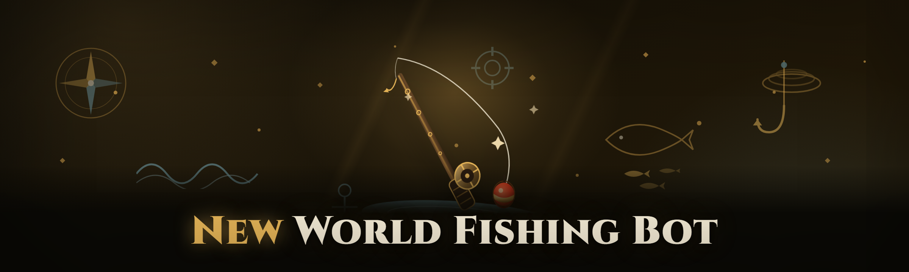

  
  
  

  

  
  

---

New World fishing bot: auto-cast, reel timing, loot detection, route cycling. Pixel-based, no injection, runs windowed or fullscreen.

## Overview

New World fishing bot: auto-cast, reel timing, loot detection, route cycling. Pixel-based, no injection, runs windowed or fullscreen.

  

## License

[MIT License](LICENSE)

  

